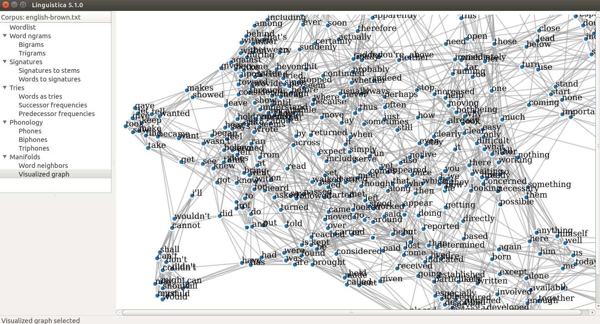

.. _index:

Linguistica 5
=============

`Linguistica 5 <https://github.com/linguistica-uchicago/lxa5>`_
is a Python library for unsupervised learning of linguistic
structure.

.. seealso::

   John Goldsmith's development code is at
   `his GitHub repository <https://github.com/JohnAGoldsmith/lxa5_0>`_.
   For Linguistica 4, see
   `Linguistica at UChicago <http://linguistica.uchicago.edu/>`_.

Linguistica 5 is available in three modes:

* Python library
* Graphical user interface (GUI)
* Command line interface (CLI)

The GUI and CLI modes use the Python library as the backend.

Citation
--------

If you use Linguistica 5, please cite this paper:

Jackson L. Lee and John A. Goldsmith. 2016.
`Linguistica 5: Unsupervised Learning of Linguistic Structure <https://aclanthology.org/N16-3005/>`_.
In *Proceedings of the 2016 Conference of the North American Chapter of the Association for Computational Linguistics: Demonstrations*, pages 22–26, San Diego, California. Association for Computational Linguistics.

.. code-block:: bibtex

   @InProceedings{lee-goldsmith:2016:lxa5,
      title = "Linguistica 5: Unsupervised Learning of Linguistic Structure",
      author = "Lee, Jackson L.  and
         Goldsmith, John A.",
      editor = "DeNero, John  and
         Finlayson, Mark  and
         Reddy, Sravana",
      booktitle = "Proceedings of the 2016 Conference of the North {A}merican Chapter of the Association for Computational Linguistics: Demonstrations",
      month = jun,
      year = "2016",
      address = "San Diego, California",
      publisher = "Association for Computational Linguistics",
      url = "https://aclanthology.org/N16-3005/",
      doi = "10.18653/v1/N16-3005",
      pages = "22--26"
   }

Technical support
-----------------

Please `open issues <https://github.com/linguistica-uchicago/lxa5/issues/new>`_
for questions and bug reports.
Alternatively, please feel free to contact
`Jackson Lee <http://jacksonllee.com/>`_ and
`John Goldsmith <http://people.cs.uchicago.edu/~jagoldsm/>`_.

Documentation
-------------

.. toctree::
   :maxdepth: 2

   download
   demo
   data
   read
   gui
   cli
   lexicon
